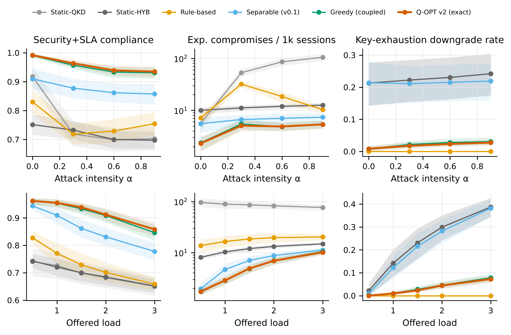
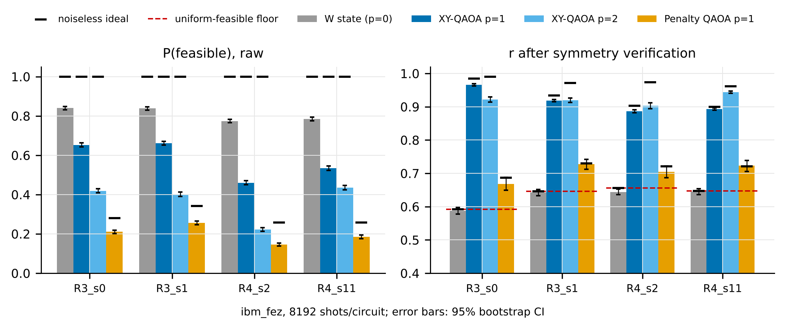
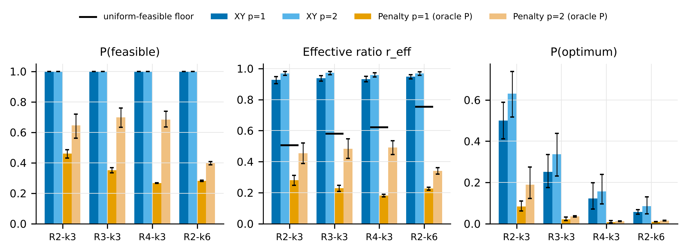

# Q-OPT v2: Coupled Crypto-Agility for QKD-PQC-QRNG Networks with Constraint-Preserving QAOA

[](https://github.com/Sumitchongder/Q-OPT/actions/workflows/ci.yml)


Q-OPT decides, every control epoch, how each service request in a
quantum-safe network is protected (by **QKD**, **PQC (ML-KEM)** or a
**hybrid** KDF combination) and over which path, when requests compete for
finite QKD key material, end-node PQC compute and QRNG entropy, under
adversarial QBER injection and link denial.

The decision problem is a block-one-hot quadratic program. We solve it
exactly and heuristically on classical hardware, evaluate it in a
hard-budget network digital twin, and execute it on IBM Quantum hardware
with an XY-mixer QAOA that never leaves the feasible subspace, which turns
the one-hot constraints into a free symmetry check for error detection.

<p align="center"></p>

*Digital twin, held-out seeds, 95 % CIs. Coupling-aware control (orange/green)
versus the v0.1 separable optimiser (blue), a tiered rule-based controller
and static policies.*

---

## Contents
1. [What is new in v2](#1-what-is-new-in-v2)
2. [Key results](#2-key-results)
3. [Quick start](#3-quick-start)
4. [Running on IBM Quantum hardware](#4-running-on-ibm-quantum-hardware)
5. [Reproducing every table and figure](#5-reproducing-every-table-and-figure)
6. [Repository layout](#6-repository-layout)
7. [Scope, assumptions and limitations](#7-scope-assumptions-and-limitations)
8. [Citation, licence, AI-assistance disclosure](#8-citation-licence-ai-assistance-disclosure)

---

## 1. What is new in v2

| | v0.1 | v2 |
|---|---|---|
| Inter-request coupling | none; the QUBO was block-separable, so greedy was provably exact | shared per-link QKD key budgets, per-node PQC CPU and QRNG entropy (convex quadratic congestion) |
| Hybrid risk | heuristic 0.85 × QKD risk | combiner property: ρ_HYB = ρ_QKD · ρ_PQC (secure if either input is secret) |
| QKD key rate | simplified pedagogical formula | Lo-Ma-Chen infinite-decoy GLLP bound, aborts above the decoy-state QBER threshold |
| Evaluation | objective value only | multi-epoch digital twin with **hard** budgets, Markov attacks, link denial, common random numbers |
| Quantum ansatz | penalty QAOA, X mixer | block XY-mixer QAOA with W-state preparation; feasibility-compressed cost Hamiltonian |
| Hardware protocol | one circuit, best-of-2000 samples on a 64-state problem | 16 pre-registered circuits, W-state and penalty controls, symmetry verification, bootstrap CIs, budget-guarded pilots |

The full derivation is in [`docs/METHODS.md`](docs/METHODS.md). Why the
change was necessary is quantified by experiment E1 below.

## 2. Key results

All numbers below are regenerated from `tables/` by
`scripts/summarize_results.py` into [`docs/RESULTS.md`](docs/RESULTS.md).

**E1: The v0.1 problem was trivial; the v2 problem is not.** Across 90
v0.1 instances the QUBO contained **0** inter-request couplings, and
per-request greedy matched the exact optimum in **100 %** of cases. In the
v2 coupled model, coupled greedy reaches the optimum in 87.5 % of instances
at R = 3, falling to 57.5 % at R = 7; the v0.1 separable rule reaches it in
≤ 2.5 %.

**E2: Coupling-awareness is what matters at network level.** Attack
intensity 0.6, load 1.5, 12 held-out seeds × 40 epochs:

| Policy | Compliance | Critical-class compliance | Key-exhaustion downgrades | Exp. compromises / 1k |
|---|---|---|---|---|
| **Q-OPT v2 (exact)** | **0.939** [0.922, 0.955] | **0.827** [0.779, 0.873] | **2.3 %** [1.5, 3.3] | 4.89 [4.01, 5.81] |
| Coupled greedy | 0.933 [0.913, 0.952] | 0.819 [0.769, 0.870] | 2.8 % [1.7, 4.1] | 4.83 [4.00, 5.72] |
| Separable (v0.1) | 0.862 [0.828, 0.894] | 0.732 [0.658, 0.800] | 21.5 % [15.6, 27.0] | 7.02 [5.49, 8.50] |
| Rule-based (tiered) | 0.729 [0.688, 0.771] | 0.374 [0.302, 0.450] | 0.0 % | 18.47 [14.23, 23.01] |
| Static-HYB | 0.700 [0.669, 0.730] | 0.273 [0.224, 0.328] | 23.1 % | 11.97 [10.69, 13.18] |

Q-OPT v2 versus every baseline: paired Wilcoxon, Holm-corrected, p < 0.01
(p = 0.023 versus coupled greedy). The advantage over v0.1 grows with load
(0.858 vs 0.778 compliance at load 3). **The gain comes from the coupled
formulation; exact optimisation adds a small, statistically detectable
improvement over coupled greedy.**

**E3: XY-QAOA as the in-loop controller.** With p = 1 angles transferred
from development instances (no training at run time), XY-QAOA matches the
control quality of uniform feasible sampling with roughly 2-4 × fewer shots
per epoch (mean objective 4.29 with 16 shots vs 4.50 for random with 32;
exact control: 4.03).

**E4: Constraint preservation beats penalties by a wide margin.**
Noiseless, 20 held-out instances per family, 6-12 qubits: XY-QAOA p = 1
reaches an effective approximation ratio of 0.93-0.95 with 100 % feasible
samples. Penalty QAOA reaches 0.18-0.28 at p = 1 and 0.34-0.49 at p = 2,
*even with a per-instance oracle-tuned penalty*.

**E6: Resources and honest scaling.** The feasibility compression removes
20-32 % of cost-Hamiltonian ZZ terms at 9-24 qubits, i.e. 9-22 % fewer CZ
gates after heavy-hex routing.
Classical simulated annealing reaches the best-found solution up to R = 30
in under 0.5 s; **we do not claim a quantum speed-up**; the quantum
contribution is a feasible-by-construction solver with a built-in error
detection mechanism, validated on hardware.

**E7: IBM Quantum hardware (ibm_fez, Heron r2, 16 circuits x 8 192 shots,
38 billed QPU seconds).** XY-QAOA p = 1 reaches r = 0.887-0.966 after
symmetry verification, within 0.007-0.018 of its noiseless value and
0.23-0.37 above the uniform-feasible floor on every instance. Its effective
ratio exceeds penalty QAOA by 0.31-0.49 on every instance (one-sided
bootstrap p <= 0.001 for all eight pre-registered tests). Raw feasibility is
0.46-0.66 for XY p = 1 against 0.15-0.26 for penalty QAOA; XY p = 2 loses
roughly half of its feasible shots to depth.

**E8: Why hardware is worse than the emulation.** A calibrated two-qubit
depolarising model predicts the emulated sector survival almost exactly
(fitted kappa_eff = 1.1 vs 12/15 from theory), but ibm_fez breaks the
symmetry sector 3.5 times faster per CZ (kappa_eff = 4.5). T1 decay of the
single excitation per block during the circuit explains about one third of
the excess; the remainder is attributed to effects outside the calibration
snapshot (crosstalk, leakage, drift). Undetected errors grow with depth
(q = 0.05 at p = 1, 0.15 at p = 2).

<p align="center"></p>

<p align="center"></p>

## 3. Quick start

```bash
conda create -n qopt python=3.12 -y && conda activate qopt
git clone https://github.com/Sumitchongder/Q-OPT.git && cd Q-OPT
pip install -r requirements.txt && pip install -e . --no-deps   # Python 3.12 (exact pins)
# Python 3.10: pip install -r requirements-py310.txt && pip install -e . --no-deps
python -m pytest tests/ -q            # 31 tests, ~2 s
```

```python
from qopt.agility.model import random_instance
from qopt.agility.solvers import solve_exact, solve_greedy
from qopt.quantum.fastsim import XYQAOASim
from qopt.quantum.train import train_depth_sweep, metrics_from_feasible_dist

prob = random_instance("C", n_requests=4, k_paths=1, seed=7, load=1.5)   # 12 qubits, 81 feasible
print(solve_exact(prob).energy, solve_greedy(prob).energy)
sim = XYQAOASim(prob)
x = train_depth_sweep(sim.expectation, p_max=2)[2][0]
print(metrics_from_feasible_dist(sim.E, sim.probs(x), 1.0))
```

## 4. Running on IBM Quantum hardware

Everything that costs QPU time lives in **one notebook**,
[`notebooks/qpu_run.ipynb`](notebooks/qpu_run.ipynb). Step-by-step
instructions, the budget logic and what to send back are in
[`docs/HARDWARE_RUN.md`](docs/HARDWARE_RUN.md). In short:

1. Run the notebook once with `USE_FAKE_BACKEND = True` (free rehearsal).
2. Save credentials once, set `USE_FAKE_BACKEND = False`, `BUDGET_SECONDS`.
3. Two pilot jobs (≈ 5 s) measure billed time; the main job's shots are
   scaled so the prediction stays under 75 % of the remaining budget.
4. Review the prediction, set `CONFIRM_SUBMIT = True`, run the cell.
5. `python experiments/exp07_hardware_analysis.py --run-dir results/hardware/run_qpu_<...>`
   then `python scripts/summarize_results.py`.

Expected cost of the full plan: ≈ 1-1.5 min of QPU time for 16 × 8 192 shots
(pessimistic estimate), leaving margin within an 8-minute allocation.

## 5. Reproducing every table and figure

```bash
bash run_all.sh          # E1-E8 (hardware analysis uses the archived QPU counts), ~25 min on one core
make results             # re-render docs/RESULTS.md
```

| Experiment | Script | Main outputs |
|---|---|---|
| E1 coupling structure | `exp01_coupling_structure.py` | `exp01_*` |
| E2 digital twin (headline) | `exp02_digital_twin.py` | `exp02_twin_*`, `exp02_trace` |
| E3 QAOA in the loop | `exp03_qaoa_in_the_loop.py` | `exp03_*` |
| E4 XY vs penalty QAOA | `exp04_ansatz_comparison.py` | `exp04_*` |
| E6 scaling & resources | `exp06_scaling_resources.py` | `exp06_*` |
| E7 hardware analysis | `exp07_hardware_analysis.py` | `exp07_<run>*` |
| E8 noise physics of the hardware run | `exp08_noise_physics.py` | `exp08_*` |

Every script is deterministic (explicit seeds, common random numbers in the
twin), writes CSVs to `tables/`, vector + raster figures to `figures/`, and a
provenance manifest (arguments, versions, git commit, runtime) to
`results/manifest/`. Evaluation seeds are disjoint from the seeds used
during development.

## 6. Repository layout

```
qopt/
  agility/   model.py    coupled block-one-hot model (risk, SLA, shared budgets)
             solvers.py  exact, separable (v0.1), rule-based, greedy, SA, tabu
             twin.py     multi-epoch digital twin with hard budgets
  quantum/   circuits.py XY-QAOA / penalty QAOA / W-state circuits (Qiskit)
             fastsim.py  exact subspace (XY) and full-space (penalty) simulators
             train.py    INTERP angle training, metrics, repair, bootstrap
             hardware.py plan building, transpilation, pilots, budget guard
  qkd/ pqc/ qrng/ threat/ network/   physical and resource models
  optimization/                      v0.1 separable QUBO (legacy comparison only)
experiments/   exp01-exp07 + _common.py (provenance, statistics, styling)
notebooks/     qpu_run.ipynb (generated by scripts/make_qpu_notebook.py)
results/       hardware/plan (plan.json, circuits.qpy), hardware/run_*, manifest/
docs/          METHODS.md, HARDWARE_RUN.md, RESULTS.md, ARCHITECTURE.md, ERRATA.md
legacy/v1/     v0.1 experiments, figures, tables and the earlier ibm_marrakesh job
tests/         test_v2.py (model, solvers, Qiskit equivalence, symmetry, budget guard)
               test_legacy_v01.py
```

## 7. Scope, assumptions and limitations

- **No quantum advantage is claimed.** At the sizes executable today the
  coupled problem is solved exactly or near-exactly by classical heuristics
  in milliseconds (E6). The hardware experiment validates a
  feasible-by-construction quantum solver and its error-detection property;
  the network-level gains (E2) come from the formulation and are solver
  agnostic.
- **Hardware instances are small and pre-registered** (R = 3-4, 9-12 qubits,
  sparse coupling; selection rule in `qopt/quantum/hardware.py`). On all
  four, coupled greedy is also optimal. Angles are trained noiselessly and
  transferred; there is no on-hardware optimisation loop.
- **Risk numbers are model outputs.** Link compromise probabilities are a
  documented proxy (attack probability × undetected fraction + control-plane
  trust), the PQC break probability ρ_PQC is a scenario parameter, and the
  hybrid product rule assumes independent failures.
- **The quadratic congestion term is a surrogate**; the twin enforces hard
  budgets, so surrogate and metric can disagree (visible as greedy slightly
  beating exact on the per-epoch objective in E3, because pool trajectories
  diverge between policies).
- **Key rates are asymptotic** (no finite-key corrections); the
  `key_rate_scale` parameter absorbs system efficiency, duty cycle and
  finite-size overhead.
- **PQC costs** use reference figures unless `liboqs-python` benchmarking is
  run (`python -m qopt.pqc.profiles --benchmark`).

## 8. Citation, licence, AI-assistance disclosure

See [`CITATION.cff`](CITATION.cff). Licence: MIT.

**AI assistance.** Parts of the v2 code, experiments and documentation were
developed with the assistance of an AI model (Anthropic Claude). All design
decisions, results and claims were reviewed by the authors, every number is
regenerated from code in this repository, and the authors take full
responsibility for the work. Journal submissions derived from this
repository must carry an equivalent disclosure, as required by IEEE and
Springer Nature policy.
